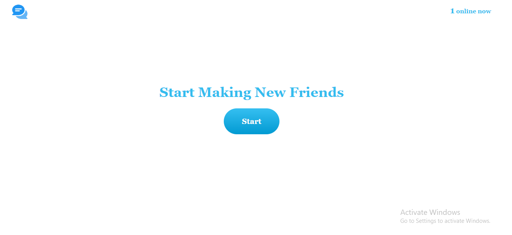

# Chat Valley

> This is video chatting application. You can chat random strangers from around the world.

## Built With

- HTML5
- CSS3
- Javascript
- WebRTC
- NodeJs
- Socket.io

## ScreenShot

## Live Demo (if available)

[Live Demo Link](https://chat-valley-zx8a.onrender.com/)

## Getting Started

This is a video chat application. Users need to allow their camera and microphone in web browsers. There is no other specification for this application.

### Deployment
In your command prompt, you need to run `npm install` to get required packages and then you can run `npm start` this website.

### Production realtime hosting

Chat Valley uses Socket.io for WebRTC signaling, so the Node server needs a persistent runtime. Deploy the server to a platform that supports long-running Node/WebSocket apps, such as Render, Railway, Fly.io, or a VPS. If the frontend is hosted separately on Vercel, set the `socket-url` meta tag in `public/index.html` to your backend URL and set `CORS_ORIGIN` on the backend to your Vercel domain.

Example:

- Frontend: `https://chat-valley.vercel.app`
- Backend: `https://chat-valley-api.onrender.com`
- Backend env: `CORS_ORIGIN=https://chat-valley.vercel.app`
- HTML: `<meta name="socket-url" content="https://chat-valley-api.onrender.com">`

## Authors

👤 **Htetaungkyaw**

- GitHub: [@githubhandle](https://github.com/Htetaungkyaw71)
- Twitter: [@twitterhandle](https://twitter.com/htetaun91907337)
- LinkedIn: [LinkedIn](https://www.linkedin.com/in/htet-aung-kyaw-9a77271a7/)

## 🤝 Contributing

Contributions, issues, and feature requests are welcome!

Feel free to check the [issues page](https://github.com/Htetaungkyaw71/Chat-Valley/issues).

## Show your support

Give a ⭐️ if you like this project!

## Acknowledgments

- Inspiration for this website is from [omegle](https://www.omegle.com/)

## 📝 License

This project is [MIT](./LICENSE) licensed.
